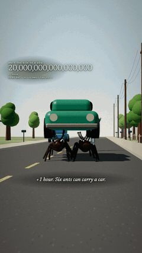
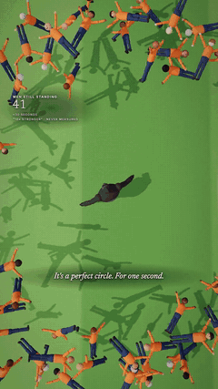
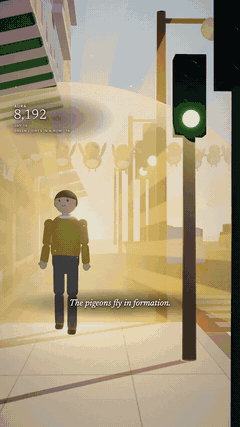
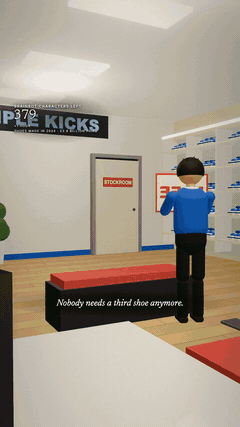
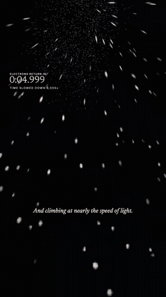
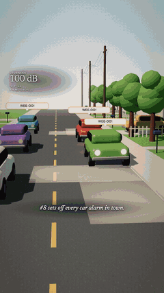
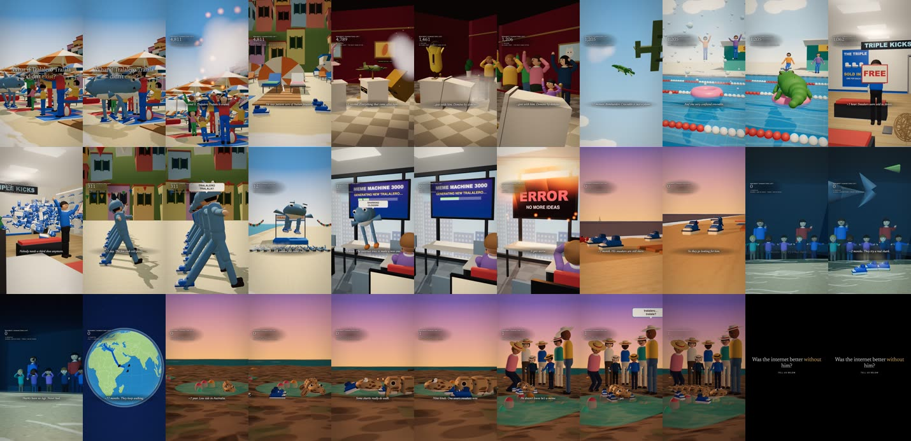
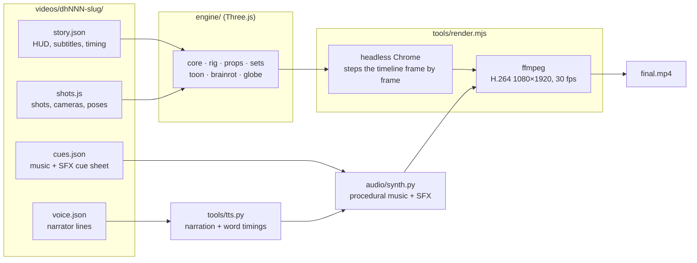

<div align="center">

# dhstudios

**The code behind [@dhstudios93](https://www.tiktok.com/@dhstudios93) on TikTok.**
Faceless 3D short-form videos where every frame is code, written and checked with Claude Code.

[](LICENSE)
[](https://threejs.org)
[](https://nodejs.org)
[](https://claude.com/claude-code)
[](https://github.com/dylann4500/EDStudio)








<sub>Frames from our videos: <i>giant ants</i> · <i>100 men vs 1 gorilla</i> · <i>aura doubles</i> · <i>no Tralalero</i> ·
<i>no electrons</i> · <i>6-7 twice as loud</i>.</sub>

[The videos](#the-videos) · [What's in here](#whats-in-here) · [How a video is made](#how-a-video-is-made) ·
[Getting started](#getting-started) · [License](#license-and-credits)

</div>

## What it is

Each video is a Three.js scene that headless Chrome renders frame by frame. Python synthesizes the music and sound effects,
a narrator voice is generated once per line where the format needs one, and ffmpeg encodes everything to 1080×1920. There's
no stock footage and no AI video.

The repo is a fork of [EDStudio](https://github.com/dylann4500/EDStudio), extended for one channel: "What if…" sims, meme
what-ifs and narrated cartoon explainers.

## The videos

One folder per video in [`videos/`](videos/): the story and timing, the 3D shots, the sound cue sheet and the caption.
The rendered videos are on [TikTok](https://www.tiktok.com/@dhstudios93), not in this repo.

| # | Video | Format |
|---|---|---|
| [dh001](videos/dh001-dollar-per-step) | What if you earned $1 for every step you took? | what-if sim |
| [dh002](videos/dh002-giant-ants) | What if ants were the size of dogs? | what-if sim |
| [dh004](videos/dh004-loved-you-back) | What if she loved you back? | meme what-if |
| [dh005](videos/dh005-no-tung-tung) | What if Tung Tung Tung Sahur didn't exist? | meme what-if |
| [dh006](videos/dh006-no-electrons) | What if electrons disappeared for five seconds? | what-if sim |
| [dh007](videos/dh007-gorilla) | What if 100 men actually fought 1 gorilla? | meme what-if |
| [dh008](videos/dh008-six-seven) | What if every time you said "6-7" it got twice as loud? | meme what-if |
| [dh009](videos/dh009-ai-girlfriend) | What if your AI girlfriend was real? | meme what-if |
| [dh010](videos/dh010-aura-doubles) | What if your aura doubled every day? | meme what-if |
| [dh011](videos/dh011-chud-to-chad) | What if you went from chud to chad? | meme what-if |
| [dh012](videos/dh012-no-tralalero) | What if Tralalero Tralala didn't exist? | meme what-if |
| [dh013](videos/dh013-coin-ridges) | Why do coins have ridges? | cartoon explainer |
| [dh014](videos/dh014-emu-war) | How did Australia lose a war to emus? | cartoon explainer |
| [dh015](videos/dh015-eiffel-sold) | The Man Who Sold the Eiffel Tower | cartoon explainer |
| [dh016](videos/dh016-pisa-dig) | The Engineers Who Saved Pisa by Digging Under It | cartoon explainer |

[`videos/lt001-look-test`](videos/lt001-look-test) is the test bed for the cartoon explainer look.
[`videos/_template`](videos/_template) is a 10-second working example to start from.

## What's in here

<table>
<tr>
<td width="50%" valign="top">

**A cartoon explainer look**<br>
Flat 2D toon characters on cards in a painted 3D world ([`engine/toon/`](engine/toon/)): world outlines, ambient
occlusion, lens blur with bokeh, two-tone light with coloured shadows, real metal, painted skies, floating dust, mood
presets, whip pans, x-ray reveals and one-word captions.

</td>
<td width="50%" valign="top">

**Narration**<br>
[`tools/tts.py`](tools/tts.py) generates each narrator line once with ElevenLabs and saves its word timings. The
timings drive the one-word captions and the shot lengths.

</td>
</tr>
<tr>
<td valign="top">

**Sets, one per place**<br>
Bedrooms, streets, suburbs, a supermarket, a stadium, the Moon, Mars, Paris, a 1690s London street, a 1925 Paris salon,
the Leaning Tower of Pisa and more ([`engine/sets/`](engine/sets/)).

</td>
<td valign="top">

**Characters and crowds**<br>
A posable toy character rig ([`engine/rig.js`](engine/rig.js)), crowds of full rigs drawn as one instanced mesh, meme
characters ([`engine/brainrot.js`](engine/brainrot.js)), a toy gorilla, dog-sized ants, cartoon emus.

</td>
</tr>
</table>

## How a video is made

1. **Story:** `videos/dhNNN-slug/story.json` holds the HUD counter, subtitles with timings and the end card. Narrated
   formats add `voice.json`, and `tools/tts.py` turns it into lines with word timings.
2. **3D shots:** `shots.js` builds the scene from `engine/sets/*`, `engine/rig.js`, `engine/props.js` and, for
   explainers, `engine/toon/`. It defines the shot list, the camera moves and the per-frame poses.
3. **Stills review:** `node tools/render.mjs dhNNN-slug --stills …` and `tools/sheet.mjs` make a contact sheet to check
   framing, light and blocking before the full render.
4. **Audio:** `cues.json` goes into `audio/synth.py` and comes out as `audio.wav`, with a loudness and dropout self-check.
5. **Render:** `node tools/render.mjs dhNNN-slug` produces `final.mp4`, then a 1-frame-per-2-s scan like this one:

<p align="center"></p>



## Getting started

Needs **Node 18+**, **Google Chrome** and **Python 3 with numpy + scipy**.

```bash
git clone https://github.com/kevinyyin/aivideos.git
cd aivideos
npm install
npm run doctor                                                       # every line should be ✅
node tools/render.mjs _template --stills 2,6,9 && node tools/sheet.mjs _template
```

Open `videos/_template/stills/_sheet.jpg`. A lit bedroom with a parent walking in means you're set.

<details>
<summary>Make a video</summary>

```bash
npm run new -- dh100-my-video                          # scaffold from the template
# edit videos/dh100-my-video/story.json + shots.js
node tools/render.mjs dh100-my-video --stills 1,5,9   # still frames -> videos/dh100-my-video/stills/
node tools/sheet.mjs dh100-my-video                    # one contact sheet of all stills
python3 -I audio/synth.py dh100-my-video               # music + SFX from cues.json -> audio.wav
node tools/render.mjs dh100-my-video                   # -> videos/dh100-my-video/final.mp4
```
Flags: `--preview` (fast draft), `--from 20 --to 28` (time range), `--cam top` (bird's-eye debug view).
Narrated videos need an ElevenLabs key in `$ELEVENLABS_API_KEY` (see `tools/tts.py`).
The narrated videos' voice audio isn't included, so re-rendering them needs that key.
</details>

## Repository layout

```
engine/   core (renderer, timeline, text overlay), rig, props, sets/, toon/ (cartoon look), brainrot, globe, sky
videos/   one folder per video: story.json + shots.js + cues.json + caption.md (+ voice.json when narrated)
audio/    synth.py: procedural music + sound-effects library
tools/    render, stills sheet, new video, doctor, narration (tts.py), caption check, chunked renders
```

## License and credits

[PolyForm Noncommercial 1.0.0](LICENSE), inherited from EDStudio: free for personal, non-commercial use, with credit kept on
every copy. Commercial use needs written permission from EDStudio's author.
- Built on [EDStudio](https://github.com/dylann4500/EDStudio): the engine, the render pipeline and the synth.
- `engine/toon/` ports techniques from [mromidev/claude-animated-shorts](https://github.com/mromidev/claude-animated-shorts) (MIT).
- Narration voices by [ElevenLabs](https://elevenlabs.io).
- The videos, the GIFs in `docs/media/` and the characters are all rights reserved.
